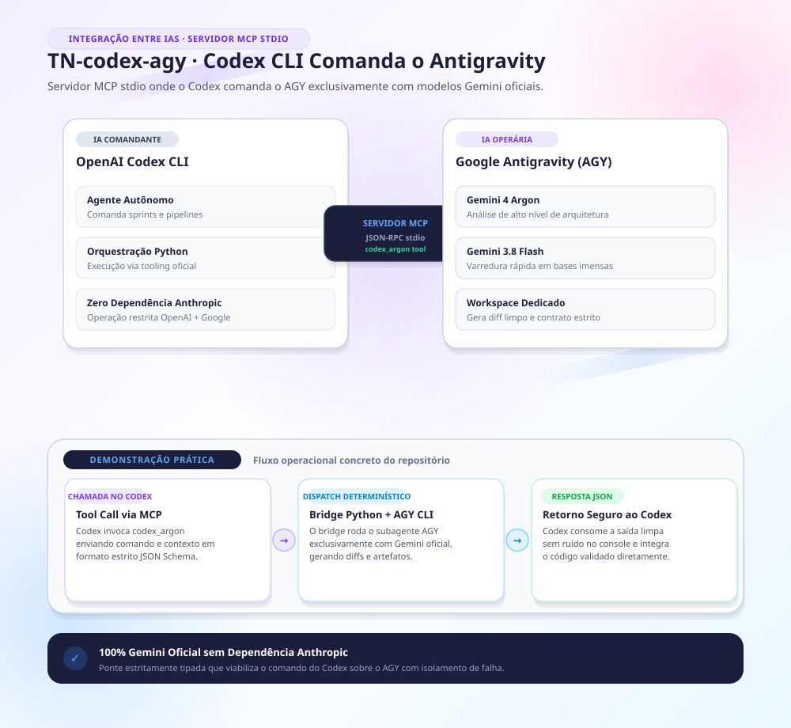

# TN-codex-agy — Ponte Codex (Comandante) → AGY (Operária)

> **Ponte local de alto desempenho onde o Codex comanda tarefas no Google Antigravity (AGY) usando exclusivamente modelos Gemini (Argon e Flash), via servidor MCP stdio e CLI Python determinístico com validação por JSON Schema.**


---

## 🏛️ 1. Arquitetura: IA Comandante & IA Operária

- **IA Comandante · Codex (Luna / Astra / Sol):** Define o escopo do trabalho, submete tarefas, acompanha o ciclo de vida dos jobs, audita os relatórios e aplica patches aprovados.
- **IA Operária · Google Antigravity (Gemini 4 Argon / 3.8 Flash):** Processa tarefas de implementação e revisão em snapshot de workspace temporário, sem tocar em APIs Anthropic/Claude.
- **Isolamento Puro Gemini:** Nenhum componente aciona Claude Code, modelos Claude ou chaves Anthropic. Não há travas artificiais de restrição ou interceptações comportamentais.

---

## 🚀 2. Instalação Multiplataforma

### Pré-requisitos
- Python 3.10+
- Git
- Google Antigravity (AGY) instalado e autenticado (`agy auth`)

### No Windows (PowerShell):
```powershell
# 1. Clone o repositório
git clone https://github.com/thalesnola/TN-codex-agy.git
cd TN-codex-agy

# 2. Instale o ambiente e dependências
.\scripts\install.ps1

# 3. Registre o servidor MCP no Codex (opcional)
.\scripts\install.ps1 -RegisterMcp
```

### No macOS / Linux (Bash):
```bash
# 1. Clone o repositório
git clone https://github.com/thalesnola/TN-codex-agy.git
cd TN-codex-agy

# 2. Crie o virtualenv e instale as dependências
python3 -m venv .venv
source .venv/bin/activate
pip install -e .
```

---

## ⚙️ 3. Configuração do Servidor MCP no Codex (`config.toml`)

Adicione o servidor MCP às configurações do Codex:

```toml
[mcp.servers.codex-agy]
command = "python"
args = ["-m", "codex_argon", "mcp"]
cwd = "/caminho/para/TN-codex-agy"
```

---

## 💻 4. Uso via CLI JSON

A ponte expõe uma interface de linha de comando determinística:

```bash
# Verificar status da ponte e modelos AGY disponíveis
python -m codex_argon status
python -m codex_argon models --refresh

# Submeter uma tarefa definida em JSON
python -m codex_argon submit ./task.json

# Acompanhar e inspecionar o resultado
python -m codex_argon jobs
python -m codex_argon result <job-id>
python -m codex_argon result <job-id> --artifact response --offset 0 --limit 4000
```

### Exemplo de Contrato de Tarefa (`task.json`):
```json
{
  "objective": "Implemente a função clamp(val, min_val, max_val) com validação de tipos.",
  "role": "implement",
  "source": "./src",
  "inputs": ["calc.py"],
  "owns": ["calc.py"],
  "acceptance": ["clamp(5, 0, 10) retorna 5", "clamp(-1, 0, 10) retorna 0"],
  "model": "gemini-4-argon-high",
  "timeout": 240
}
```

---

## 🧪 5. Validação e Testes Automatizados

A suíte de testes utiliza um AGY mock determinístico para validar contratos, isolamento de workspaces e idempotência:

```bash
# Execução dos testes via pytest
python -m pytest tests/ -v
```
